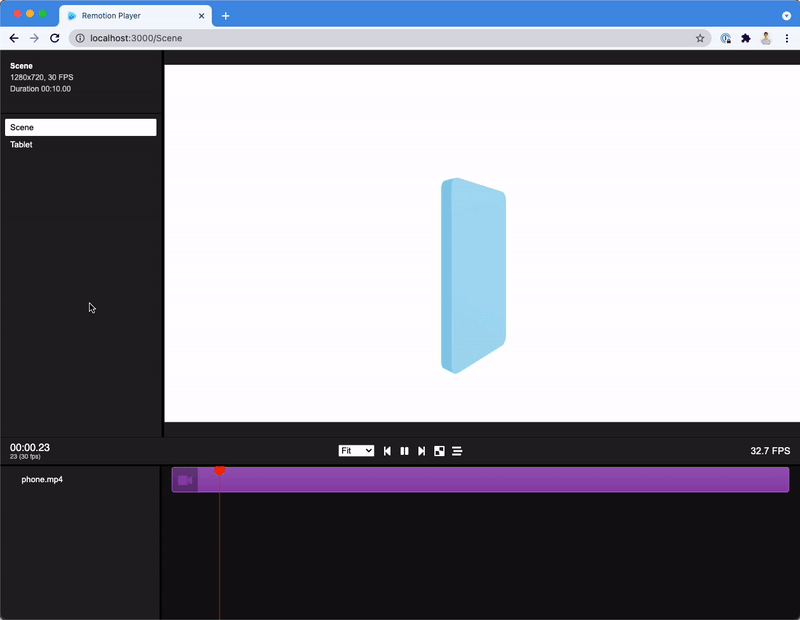

# Zack 3D Explainer

3D explainer videos built with [Remotion](https://remotion.dev) and
[React Three Fiber](https://docs.pmnd.rs/react-three-fiber) (Three.js).

**All development and rendering happens in GitHub Codespaces.** You don't need
anything installed locally (a Chromebook with a browser is enough), and there
are no paid services, Blender, or GPU requirements.

The project currently contains the original Remotion Three.js starter demo: a
rotating phone that plays a video on its screen. It's kept as a working
reference until the real scenes are built.

<p align="center">
    
</p>

## 1. Open a Codespace

1. On the GitHub repository page, click **Code → Codespaces → Create codespace
   on main** (or on the branch you want to work on).
2. Wait for setup to finish. The first time it takes a few minutes. The
   Codespace automatically:
   - uses Node.js 22,
   - installs the system libraries Remotion's headless Chrome needs,
   - runs `npm ci` to install the project dependencies,
   - downloads Remotion's headless Chrome (`npx remotion browser ensure`).

   You can watch progress in the **Terminal** panel ("postCreateCommand").
   Setup is defined in [`.devcontainer/`](.devcontainer).

If setup was interrupted, you can rerun it at any time with:

```bash
bash .devcontainer/post-create.sh
```

## 2. Start Remotion Studio (preview)

In the Codespace terminal:

```bash
npm run dev
```

Studio starts on port **3000**. Codespaces forwards the port and opens it in a
new browser tab. If the tab doesn't open, go to the **Ports** panel and click the
globe icon next to port 3000 ("Remotion Studio").

In Studio you can:

- pick a composition in the left sidebar (currently `Scene`),
- scrub the timeline and press play to preview,
- change props such as `phoneColor` and `deviceType` in the right panel.

The preview runs in *your* browser, so it uses your own computer's graphics. That's
fine for previewing. The final video is always rendered on the Codespace.

## 3. Render an MP4

```bash
npm run render
```

This renders the `Scene` composition to `out/scene.mp4`. To render a different
composition or file name:

```bash
npx remotion render <CompositionId> out/<name>.mp4
```

Render a single frame as a PNG (useful for quick checks):

```bash
npx remotion still Scene out/frame.png --frame=60
```

To download the result, right-click the file in the Codespace **Explorer** (`out/`
folder) and choose **Download…**. The `out/` folder is ignored by Git.

### Why `swangle`?

Codespaces have no GPU. Three.js needs WebGL, and on a GPU-less machine
Chrome can only provide WebGL through **SwiftShader** (a CPU-based renderer)
running behind **ANGLE**. Remotion calls this combination `swangle`.

It's set as the default in [`remotion.config.ts`](remotion.config.ts):

```ts
Config.setChromiumOpenGlRenderer("swangle");
```

so every `remotion render` / `remotion still` uses it automatically, and you
don't need to pass `--gl=swangle`. Passing it explicitly is harmless. Other values
(e.g. `angle`, `egl`) fail on Codespaces with *"Error creating WebGL context"*.

CPU rendering is slower than GPU rendering. Renders take longer on small
Codespaces machines, so pick a larger machine type when creating the Codespace
if you need faster renders. Note that larger machines use up your free
Codespaces hours faster.

## Project structure

| Path | Purpose |
| --- | --- |
| `src/index.ts` | Entry point; registers the root component. |
| `src/Root.tsx` | Lists all compositions (id, size, fps, duration). |
| `src/Scene.tsx` | The demo composition: sets up the `<ThreeCanvas>` and lights. |
| `src/Phone.tsx` | The 3D phone with a video texture on its screen. |
| `src/RoundedBox.tsx`, `src/helpers/` | Geometry and layout helpers for the phone. |
| `public/` | Static assets (videos, images) loaded with `staticFile()`. |
| `remotion.config.ts` | Render settings (`swangle`, JPEG frames, Rspack). |
| `.devcontainer/` | Codespaces setup. |

## Other commands

```bash
npm run lint      # ESLint + TypeScript type check
npx remotion upgrade   # upgrade all Remotion packages together
```

## Notes

- **Stills of the demo show a black phone screen.** In the demo, the video
  texture updates one frame late during rendering. A single `remotion still`
  therefore has no video on the screen yet. Full MP4 renders show the video
  normally. This is existing behaviour of the starter demo and not related to
  `swangle`.
- Remotion versions are pinned in `package-lock.json`. Use `npm ci` (not
  `npm install`) to reproduce exactly the installed versions, and
  `npx remotion upgrade` to update them together.

## Docs

- [Remotion fundamentals](https://www.remotion.dev/docs/the-fundamentals)
- [@remotion/three](https://remotion.dev/docs/three)
- [React Three Fiber](https://docs.pmnd.rs/react-three-fiber/getting-started/introduction)
- [Remotion GL options](https://www.remotion.dev/docs/gl-options)

## License

Remotion is free for individuals and small teams. Some companies need a
company license. [Read the terms here](https://github.com/remotion-dev/remotion/blob/main/LICENSE.md).
